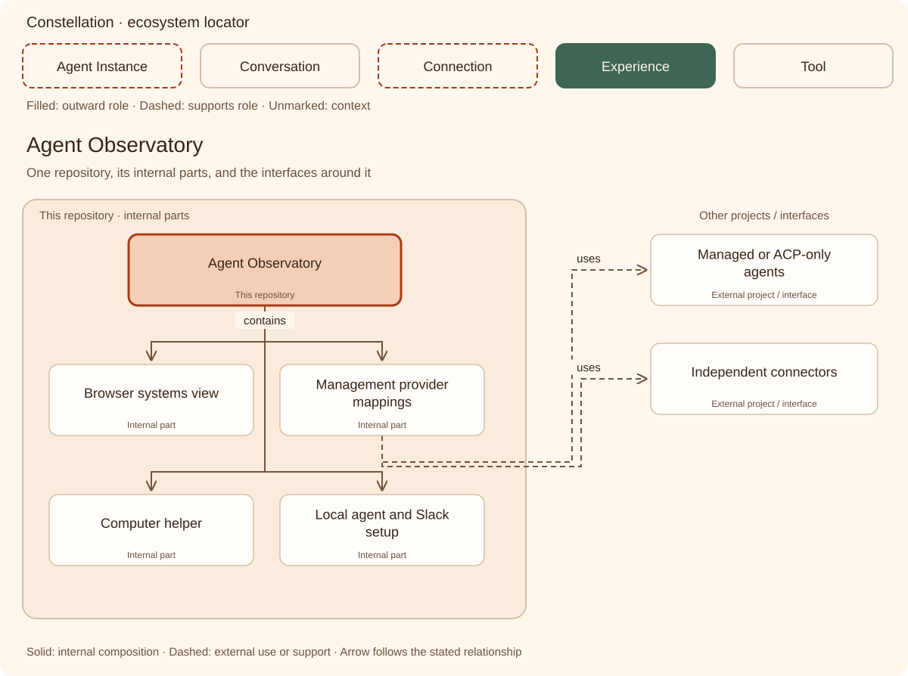

# Agent Observatory

Observatory gives you one place to see your computers, agents, and their
connections. Create an agent, connect one you already run, or pair another
computer so you can manage agents there too.

It is an optional part of [Amplifier Constellation](https://github.com/microsoft/amplifier-constellation).
Agents keep their own identities, settings, credentials, and work.

## Get started

1. Download the **desktop** package for your operating system and processor from
   [Releases](https://github.com/microsoft/amplifier-constellation-observatory/releases).
2. Extract the complete download and keep its support folder with the app.
   Open **Observatory** on macOS, `agent-observatory.exe` on Windows, or
   `agent-observatory` on Linux.
3. The app opens in your browser. Choose a name and password for this local
   installation. You can also choose to start it when you sign in.
4. Select your computer and choose **Create an agent**. Name it and confirm
   installation, then connect its model account and any services you want to use.

Reopening the app returns to the same installation. Local setup does not require
a certificate, remote account, GPU, or developer tools. Creating an agent does not
prompt a model or install a Minecraft server.

Packages target Windows 11, macOS, and Linux on Intel/AMD and ARM processors.
Windows and macOS downloads are unsigned previews; keep OS security protections
enabled and review any launch warning. A smaller server package connects existing
installations but omits local agent setup.

## Connect an existing agent

Choose **Add → Connect an existing agent**, enter its HTTPS management address
and credential, and check the observed identity. An unreachable agent remains
saved as unverified. Use **Advanced controls → Connect existing** for an ACP-only
agent or an explicit SSH attach command.

## Add another computer

Choose **Add a computer → Use this network**, select a reachable LAN or private
network address, and download the helper setup for the other computer. Open it
there and enter the code shown in Observatory.

Both computers need a route to each other and the selected listener must be
allowed through the firewall. Pairing does not create a network route or change
firewall rules. Allow agent setup during pairing if you want to create agents on
that computer; observation-only pairing leaves installation controls disabled.

## Update Observatory

Open a newer matching download and choose **Update and reopen**. Observatory waits
for active work before replacing its app files. Your account, canvas, connections,
and independently running agents remain in place; a failed startup restores the
previous app.

## For developers and administrators

See the [API reference](docs/api.md), [interface agreements](docs/contracts.md),
and [validation guide](docs/validation.md). The [vision](docs/VISION.md) explains
Observatory's direction. [Existing-service adoption](docs/existing-service-adoption.md)
covers older Linux installations.

<!-- ecosystem-map:start -->
## Where this fits

An optional management experience over independently owned agents, computers and connections.

Roles: Experience. Supports: Agent Instance, Connection.

[Open the map](docs/ecosystem-map.svg) · [Product overview](https://microsoft.github.io/amplifier-constellation/projects/amplifier-constellation-observatory/) · [Map guide](https://github.com/microsoft/amplifier-constellation/blob/main/docs/ecosystem-maps.md)

The five shared building blocks

<!-- ecosystem-map:end -->

## Contributing

> [!NOTE]
> This project is not currently accepting external contributions, but we're actively working toward opening this up. We value community input and look forward to collaborating in the future. For now, feel free to fork and experiment!

Most contributions require you to agree to a
Contributor License Agreement (CLA) declaring that you have the right to, and actually do, grant us
the rights to use your contribution. For details, visit [Contributor License Agreements](https://cla.opensource.microsoft.com).

When you submit a pull request, a CLA bot will automatically determine whether you need to provide
a CLA and decorate the PR appropriately (e.g., status check, comment). Simply follow the instructions
provided by the bot. You will only need to do this once across all repos using our CLA.

This project has adopted the [Microsoft Open Source Code of Conduct](https://opensource.microsoft.com/codeofconduct/).
For more information see the [Code of Conduct FAQ](https://opensource.microsoft.com/codeofconduct/faq/) or
contact [opencode@microsoft.com](mailto:opencode@microsoft.com) with any additional questions or comments.

## Trademarks

This project may contain trademarks or logos for projects, products, or services. Authorized use of Microsoft
trademarks or logos is subject to and must follow
[Microsoft's Trademark & Brand Guidelines](https://www.microsoft.com/legal/intellectualproperty/trademarks/usage/general).
Use of Microsoft trademarks or logos in modified versions of this project must not cause confusion or imply Microsoft sponsorship.
Any use of third-party trademarks or logos are subject to those third-party's policies.
